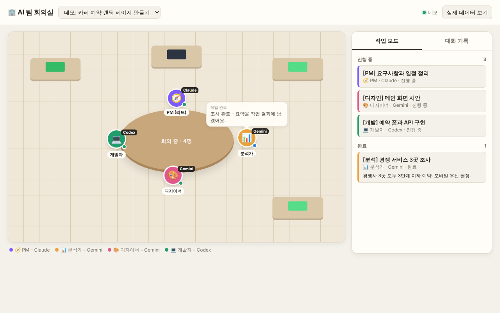

# 시놀로지 NAS에 Orca 서버 올리기 (DS225+)

NAS에서 Orca를 화면 없이(`orca-ide serve`) 24시간 돌리고, PC와 모바일은 Tailscale로 접속해서 지시만 하는 구성입니다.

```
[폰: Orca 앱]  ─┐
[PC: Orca 앱/브라우저] ─┼── Tailscale (사설 VPN) ──> [NAS: orca 컨테이너 :6768]
                                                   ├ Claude Code / Codex / Gemini CLI
                                                   └ /workspace (git 프로젝트)
```

이 폴더의 파일:

| 파일 | 역할 |
|---|---|
| `Dockerfile` | Ubuntu 24.04 + Orca(AppImage 압축 해제) + Node 22 + Claude Code·Codex·Gemini CLI + git·gh |
| `entrypoint.sh` | NAS 사용자 권한으로 바꾼 뒤 `orca-ide serve` 실행 |
| `docker-compose.yml` | Container Manager 설정 (포트, 볼륨). 개인 값은 `.env`에서 읽습니다 |
| `.env.example` | 개인 설정 예시. `.env`로 복사해서 씁니다 (`.env`는 Git에 올라가지 않음) |
| `meeting-room/` | AI 팀 회의실 페이지 (포트 6769). 사용법은 아래 9번과 `meeting-room/TEAM_PROMPT.md` |

> 테스트 결과(2026-11-02): 이미지 빌드, 서버 기동(`Orca server ready`), 터미널 데몬 자가진단, 재시작 후 유지, 데스크톱·모바일 페어링 링크 출력, 브라우저용 웹 클라이언트(HTTP 200)까지 확인했습니다. 실제 NAS와 폰 연결은 아래 단계에서 직접 확인이 필요합니다.

---

## 0. 미리 알아둘 것

- **QuickConnect는 쓰지 않습니다.** QuickConnect는 DSM 자체 서비스만 중계해서 Orca 포트(6768)에는 쓸 수 없습니다. Orca 공식 문서도 포트를 인터넷에 열지 말고 Tailscale 같은 사설망을 쓰라고 합니다. 공유기 포트포워딩도 하지 마세요.
- **메모리:** DS225+ 기본 2GB는 빠듯합니다. Orca 서버와 AI CLI 여러 개가 동시에 돌면 부족할 수 있어 6GB로 늘리는 것을 권장합니다.
- **AI 로그인:** Orca는 API 키가 아니라 각 CLI(Claude Code, Codex, Gemini)의 구독 로그인으로 동작합니다. 로그인 정보는 NAS의 `home` 폴더에 저장되어 재시작해도 유지됩니다.
- Remote Orca Server 기능은 아직 **베타**입니다.

## 1. NAS 준비

1. **패키지 센터**에서 **Container Manager**와 **Tailscale**을 설치합니다.
2. Tailscale 앱을 열어 로그인합니다. https://login.tailscale.com/admin/machines 에서 NAS의 **100.x.y.z** 주소를 메모합니다.
3. PC와 휴대폰에도 Tailscale 앱을 설치하고 **같은 계정**으로 로그인합니다.
4. **File Station**에서 `docker` 공유폴더 아래에 다음 폴더를 만듭니다.
   ```
   /docker/orca
   /docker/orca/home
   /docker/orca/workspace
   ```
5. 이 저장소 파일을 `/docker/orca`에 받습니다. 아래 **Git으로 받기**를 따르거나, zip으로 받아 업로드해도 됩니다. 필요하면 `.env.example`을 `.env`로 복사합니다.

## 2. 설정값 채우기

1. **제어판 → 터미널 및 SNMP**에서 SSH를 켜고, PC에서 접속합니다: `ssh 내아이디@NAS주소`
2. `id`를 입력해 `uid=`(보통 1026)와 `gid=`(보통 100) 값을 확인합니다.
3. 기본값(uid 1026, gid 100, Tailscale IP 100.119.72.114)과 다르면 `.env` 파일에 적습니다.
   ```bash
   cp .env.example .env
   nano .env   # PUID, PGID, ORCA_PAIRING_ADDRESS 확인
   ```

## 3. 컨테이너 만들기

1. **Container Manager → 프로젝트 → 생성**
2. 프로젝트 이름 `orca`, 경로 `/docker/orca`, "기존 docker-compose.yml 사용"을 고릅니다.
3. 다음을 눌러 빌드합니다. 처음엔 10~20분 걸립니다.
4. 끝나면 컨테이너 `orca`의 로그에 `Orca server ready`가 보이면 성공입니다.

> `[agent-state-rules] download failed: HTTP 404` 경고는 무시해도 됩니다.

## 4. AI와 GitHub 로그인 (한 번만)

SSH에서 컨테이너 안으로 들어갑니다.

```bash
sudo docker exec -it -u orca orca bash -l
```

안에서 차례로 실행합니다. 각각 로그인 링크나 코드가 나오면 PC 브라우저에서 승인하면 됩니다.

```bash
claude                      # Claude Code 로그인 후 /exit
codex login --device-auth   # ChatGPT 계정으로 Codex 로그인
gemini                      # Google 계정 로그인 후 /quit
gh auth login               # GitHub 로그인 (HTTPS 선택)
git config --global user.name  "이름"
git config --global user.email "메일"
exit
```

Orca 안에서 계정 전환 기능까지 쓰고 싶다면 같은 셸에서 `orca-ide account add --agent claude`(또는 `codex`)로 등록할 수 있습니다. Gemini는 이 명령을 지원하지 않아 위의 `gemini` 로그인만으로 충분합니다.

## 5. PC 연결

0. `.env`에서 `ORCA_PAIRING_MODE=desktop`으로 바꾸고 `sudo docker compose up -d`를 실행합니다.
1. SSH에서 `sudo docker logs orca`를 실행해 **Pairing URL** (`orca://pair?code=...`)을 복사합니다.
2. PC의 Orca 데스크톱 앱 → **Settings → Remote Orca Servers → Add Server**에 붙여 넣습니다.
3. 앱 없이 쓰고 싶다면 로그의 **Web client URL** (`http://100.x.y.z:6768/web-index.html#pairing=...`)을 브라우저로 열어도 됩니다.

## 6. 모바일 연결

1. `.env`에서 `ORCA_PAIRING_MODE=mobile`로 바꾸고 `sudo docker compose up -d`를 실행합니다.
2. SSH에서 `sudo docker logs orca`를 실행하면 QR 코드가 나옵니다. DSM 로그 화면에서는 QR이 깨질 수 있으니 SSH 창을 쓰세요.
3. Orca 모바일 앱 → **Pair**에서 QR을 스캔하거나 링크를 붙여 넣습니다. 폰의 Tailscale이 켜져 있어야 합니다.

## 7. 페어링이 끝나면

`.env`에서 `ORCA_PAIRING_MODE=off`로 바꾸고 `sudo docker compose up -d`를 실행합니다. 이미 연결된 기기는 그대로 유지되고, 로그에 새 페어링 링크가 남지 않습니다. 기기를 새로 추가할 때만 `desktop`이나 `mobile`로 잠깐 바꾸면 됩니다.

## 8. 첫 작업 테스트

PC나 폰의 Orca에서 NAS 서버를 선택하고 저장소를 `/workspace`에 클론한 뒤, 작업(worktree)을 하나 만들어 에이전트에게 간단한 수정을 시켜봅니다. 파일은 File Station의 `/docker/orca/workspace`에서도 보입니다.

---

## 9. AI 팀 회의실 (2026-11-03 추가)

PM, 개발자, 디자이너, 분석가, QA 역할을 맡은 AI들이 일을 나누고 대화하는 모습을 2D 사무실로 보여주는 페이지입니다. Orca의 orchestration(작업, 작업자, 메시지) 데이터를 4초마다 읽어 그립니다.

- 메시지가 오가면 보낸 쪽과 받는 쪽이 회의 테이블로 모이고, 말풍선과 ✉️가 날아갑니다. 조용해지면 각자 자리로 돌아갑니다.
- 오른쪽에 작업 보드(진행 중, 대기, 막힘, 완료, 실패)와 대화 기록이 있습니다.
- 역할은 작업 제목의 머리말(`[개발]`, `[디자인]` 등)로 구분합니다.



**이미 설치한 경우:** 아래 "Git으로 받기와 업데이트"대로 받은 뒤 `sudo docker compose up -d --build`를 실행하고, PC나 폰 브라우저(Tailscale 켠 상태)에서 `http://100.119.72.114:6769` 를 엽니다. 회의실은 기본으로 켜져 있어 따로 설정할 것이 없습니다. 아직 회의가 없으면 오른쪽 위 **데모 보기**로 움직임을 먼저 볼 수 있습니다.

**회의 시작하기:** Orca에서 Claude 에이전트를 하나 열고 [`meeting-room/TEAM_PROMPT.md`](meeting-room/TEAM_PROMPT.md)의 프롬프트를 붙여 넣으세요. 그 Claude가 PM이 되어 Codex와 Gemini에게 일을 나눕니다.

**접근 제한(선택):** `.env`에 `MEETING_ROOM_TOKEN=원하는단어`를 넣으면 `http://…:6769/?token=원하는단어`로만 열립니다.

## Git으로 받기와 업데이트

저장소: https://github.com/bluewind201/Orca_tools

처음 한 번 (이미 `/docker/orca`에 설치해서 쓰는 중이어도 됩니다):

```bash
cd /volume1/docker/orca
sudo git init -b main
sudo git remote add origin https://github.com/bluewind201/Orca_tools.git
sudo git fetch origin main
sudo git checkout -f -B main origin/main
```

- DSM에 `git`이 없다면 **패키지 센터 → Git Server**를 설치하세요.
- 비공개 저장소라면 사용자 이름과 비밀번호를 물어봅니다. 비밀번호 자리에는 GitHub 비밀번호가 아니라 **Personal Access Token**을 넣어야 합니다. GitHub → Settings → Developer settings → Fine-grained tokens에서 이 저장소의 Contents 읽기 권한으로 만들 수 있어요.
- `.env`, `home/`, `workspace/`는 Git이 건드리지 않습니다. 로그인 정보와 프로젝트는 그대로 유지돼요.
- 예전에 직접 고친 `docker-compose.yml`은 Git 버전으로 덮어써집니다. uid나 IP가 기본값과 다르면 먼저 `.env`에 옮겨 적어 주세요.

이후 업데이트할 때:

```bash
cd /volume1/docker/orca
sudo git pull
sudo docker compose up -d --build
```

개인 설정은 `.env`에만 두면 업데이트할 때 손댈 것이 없습니다.

## 운영 메모

- **Orca 업데이트:** Container Manager → 프로젝트 `orca` → **빌드**를 다시 하면 최신 Orca를 받아옵니다. 로그인과 프로젝트는 `home`, `workspace` 폴더에 있어 유지됩니다.
- **NAS 재부팅:** `restart: unless-stopped` 설정이라 자동으로 다시 켜집니다.
- **보안:** 페어링 링크는 비밀번호처럼 다루세요. DSM 방화벽을 쓴다면 6768, 6769 포트는 `100.64.0.0/10`(Tailscale)과 내부망에서만 허용하세요. 연결된 기기는 PC 앱의 Shared Server Access에서 끊을 수 있습니다.
- **백업:** `/docker/orca/home`에는 AI 로그인 정보가 들어 있으니 외부 공유나 공개 백업에 넣지 마세요.
